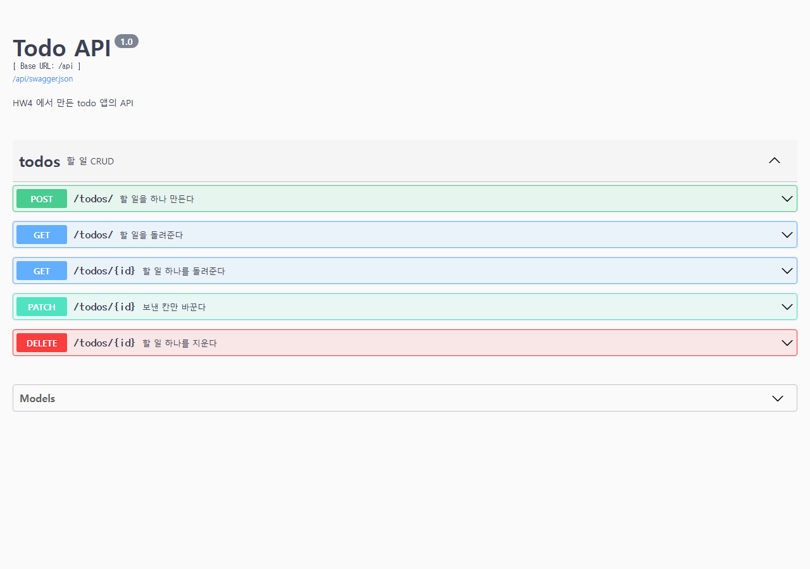
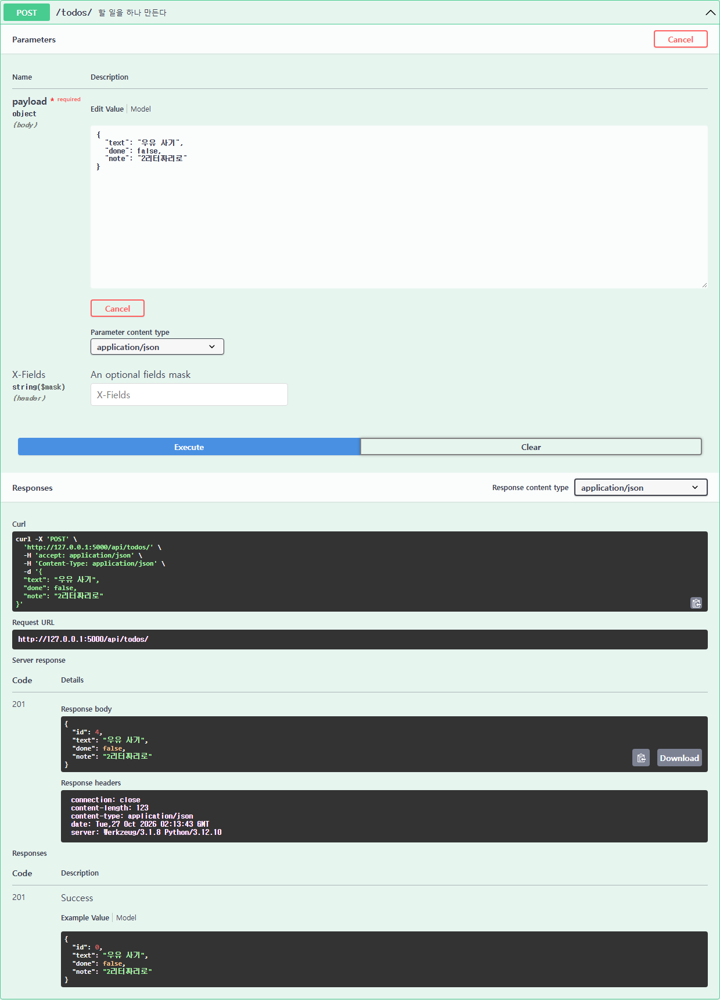
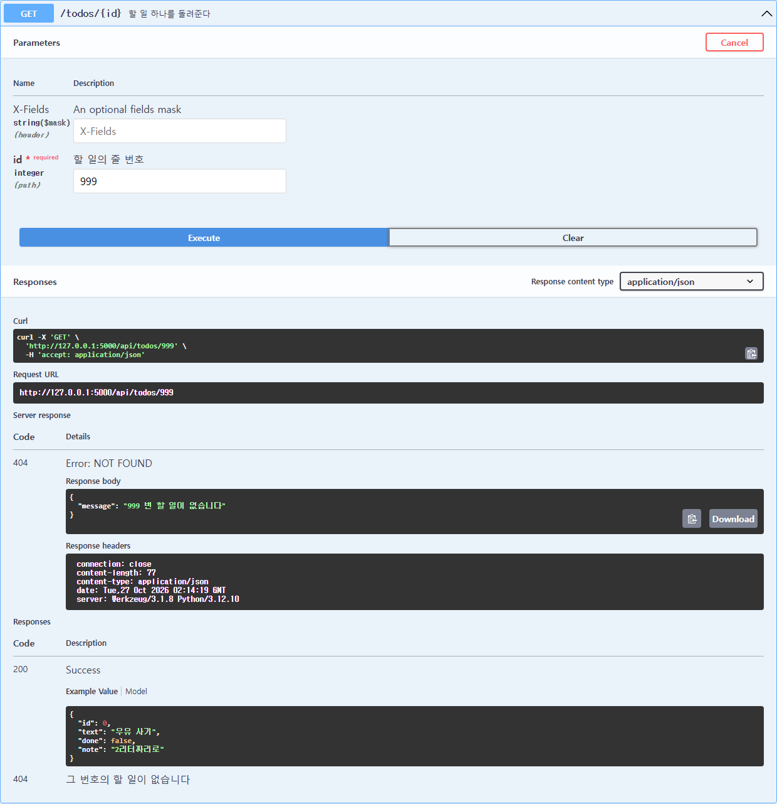

# HW4 : todo 앱에 API 더하기

2차시에서 만든 Flask-RESTX 기반 `/api/todos` API 에 설명 칸(`note`)과 완료 여부 필터링(`?done=`)을
더했습니다. 화면(템플릿)도 HW3 의 할 일 목록/수정 화면을 그대로 가져와 `note` 칸과 함께 씁니다.

## 더한 것
- 설명 칸(`note`)을 API 로도 주고받게 했습니다. 안 보내면 빈 글자(`""`)가 들어갑니다.
- `GET /api/todos/?done=true` / `?done=false` 로 완료 여부에 따라 걸러서 받을 수 있게 했습니다.
  `done` 을 안 보내면 지금까지처럼 전부 돌려줍니다.
- 없는 번호를 부르면 `404` 와 `{"message": "<번호> 번 할 일이 없습니다"}` 를 돌려줍니다.

## 실행하는 법
```
pip install -r requirements.txt
cd HW4
flask --debug run
```
화면 http://127.0.0.1:5000/
문서 http://127.0.0.1:5000/api/docs

## 테스트
```
cd HW4
python -m unittest -v
```
`test_api.py` 는 `app.py` 를 가져올 때 `TODO_DATABASE_URI` 환경 변수로 메모리 DB(`sqlite:///:memory:`)를
먼저 지정합니다. Flask-SQLAlchemy 는 `SQLAlchemy(app)` 을 만드는 시점의 설정으로 엔진을 한 번만
만들기 때문에, import 가 끝난 뒤에 설정을 바꾸는 방식으로는 실제 DB(`instance/todo.db`)를 테스트가
건드리는 걸 막을 수 없습니다. 그래서 import 전에 환경 변수로 미리 지정해 둡니다. 내 할 일 목록은
건드리지 않습니다.

## 고친 곳 (app.py)
- `Todo` 모델에 `note` 칸 추가 (HW3 에서 가져옴)
- `todo_model` / `todo_input` 에 `note` 필드 추가
- `POST` : `api.payload.get("note", "")` 로 안 보내도 빈 글자가 들어가게 함
- `PATCH` : 보낸 칸만 바꾸도록 `"note" in payload` 로 확인 후 반영
- `TodoList.get` : `?done=` 을 읽어 `filter_by(done=...)` 로 거름. 안 보내면(`None`) 전체 반환
- `@ns.param("done", ...)` 로 Swagger UI 에 `done` 입력 칸이 보이게 함
- `ERROR_404_HELP = False` 로 404 메시지에 Swagger UI 기본 안내문이 덧붙지 않게 함

## 명세 확인 (81쪽 표)
| 보낸 것 | 돌아온 것 |
|---|---|
| `POST /api/todos/ {"text":"우유 사기","note":"2리터짜리로"}` | `201` `{"id":...,"text":"우유 사기","done":false,"note":"2리터짜리로"}` |
| `POST /api/todos/ {"text":"책 반납"}` | `201` `note` 가 `""` |
| `GET /api/todos/<id>` | `200` 네 칸 그대로 |
| `PATCH /api/todos/<id> {"done":true}` | `200` `done` 만 바뀌고 `text`, `note` 는 그대로 |
| `GET /api/todos/` | `200` 전부 |
| `GET /api/todos/?done=true` / `?done=false` | `200` 각각 완료 / 미완료만 |
| `DELETE /api/todos/<id>` | `204` 본문 없음 |
| `GET /api/todos/999` | `404` `{"message": "999 번 할 일이 없습니다"}` |

## 화면

### 1. 주소가 모두 보이는 문서 (todos 묶음을 펼친 모습)


### 2. note 를 넣어 만들었더니 201 이 온 모습


### 3. 없는 번호를 불렀더니 404 가 온 모습

